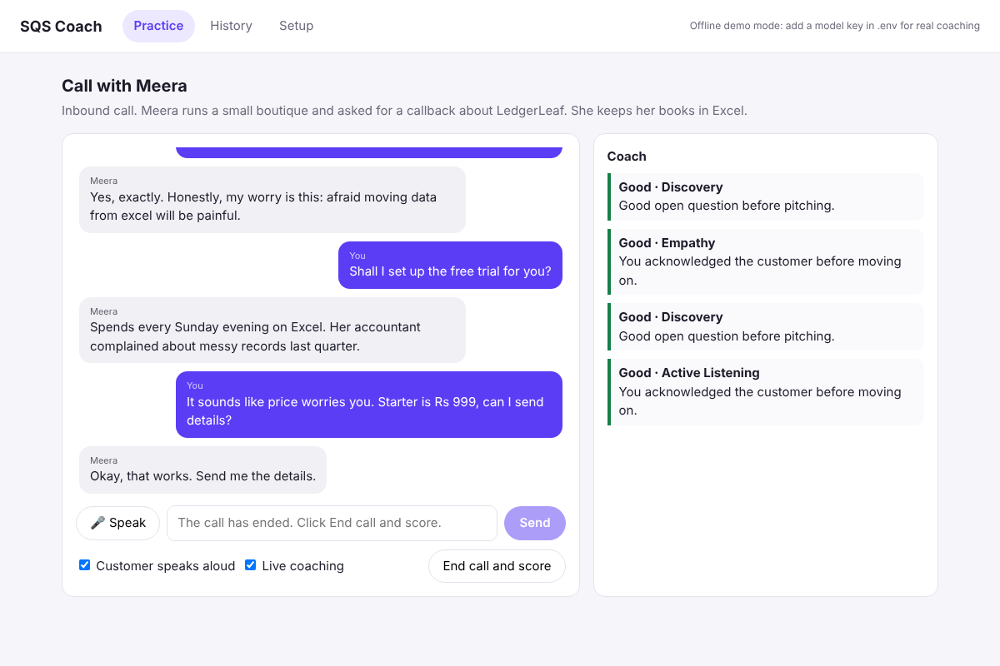

# SQS Coach

Practise sales calls with an AI customer. A coach comments on each reply and ends the call with an SQS scorecard: what was good, what to change, and what to say instead.

Status: local prototype.



## Run it

```
./run.sh
```

Open http://localhost:8100 in Chrome. Put your model key in `.env` (`ANTHROPIC_API_KEY=...`) for real coaching. Without a key it runs in offline demo mode: a scripted customer and rule-of-thumb scores, enough to show the flow.

With Docker: `docker compose up --build`.

## How a session works

1. Pick a customer scenario. You see a short brief. The customer's real concerns stay hidden.
2. Talk to the customer by typing or with the Speak button (Chrome speech recognition). The customer can speak aloud.
3. After each reply the coach notes one behaviour: good, mixed or improve, with a line to try instead.
4. End the call. The scorecard gives each SQS behaviour a score from 1 to 5 with your own words as evidence, and a weighted SQS percentage.
5. History shows your SQS trend and your average on each behaviour.

## Make it yours

- **Product facts:** Setup tab, or `config/product.md`. The coach marks down any claim these facts don't support.
- **SQS rubric:** `config/rubric.json`. Names, descriptions and weights. The sample rubric is a starting point, not your official SQS.
- **Customers:** Setup tab drafts a scenario from one sentence. Built-in ones are in `config/scenarios.json`.
- **Model:** `LLM_PROVIDER=anthropic`, or `openai_compatible` with `LLM_BASE_URL` for a company gateway.

## Check it

```
.venv/bin/pytest -q          # 8 tests, no key needed
.venv/bin/python -m app.evals   # a strong agent must outscore a weak one by 15+ points
```

See [docs/plan.md](docs/plan.md) for what is built and what comes next.
