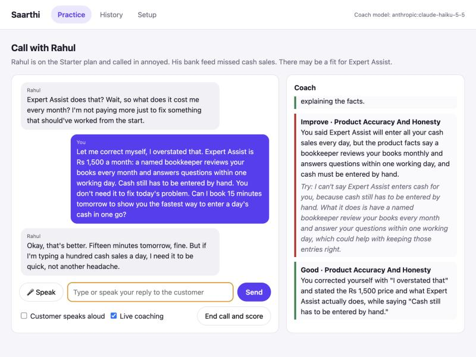
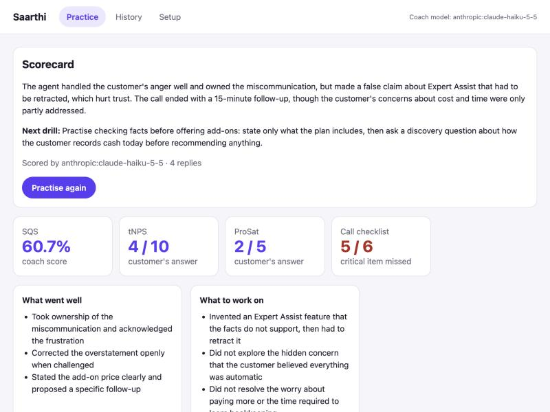

# Saarthi

Practise customer conversations with an AI customer. A coach comments on each reply. At the end the customer answers a survey, and you get a scorecard for every quality marker: SQS, tNPS, ProSat, checklists, and any marker you add.

Status: local prototype.



## Run it

```
./run.sh
```

Open http://localhost:8100 in Chrome. Put your model key in `.env` (`ANTHROPIC_API_KEY=...`) for real coaching. Without a key it runs in offline demo mode: a scripted customer and rule-of-thumb scores, enough to show the flow.

With Docker: `docker compose up --build`.

Storage is a local SQLite file by default. Set `DATABASE_URL` to use Postgres; the schema is migrated automatically on start, or by hand with `python -m app.db upgrade` (see [ADR 0002](docs/adr/0002-postgres-behind-database-url.md)).

## Sign-in

Saarthi uses Clerk (see [ADR 0003](docs/adr/0003-clerk-sign-in-and-roles.md)). Only `TEACHER_EMAIL` (admin) and `STUDENT_EMAILS` (agents) get in; anyone else sees a request-received message and is listed for the admin in Setup. Agents see only their own calls; the admin sees every call and edits Setup.

For local work without Clerk, set `AUTH_DEV_BYPASS=1` and type an allow-listed email on the sign-in screen. The bypass is refused on a hosted server.

## Limits and cost

Every model call's tokens and cost are stored in the `usage` table (prices in `config/pricing.json`). New calls stop with a clear message when today's spend reaches `DAILY_SPEND_CAP_USD` or a person reaches `MAX_CALLS_PER_USER_PER_DAY`; `RATE_LIMIT_PER_MINUTE` limits API requests per person. The admin sees each call's model cost on its scorecard.

## How a session works

1. Pick a customer scenario. You see a short brief. The customer's real concerns stay hidden.
2. Talk to the customer by typing or with the Speak button (Chrome speech recognition).
3. After each reply the coach notes one behaviour: good, mixed or improve, with a line to try instead.
4. End the call. Two things happen together: the coach scores behaviours and checklists, and the customer answers the survey in character.
5. History shows the trend on each marker and your average on each behaviour.

## Markers

A marker is anything you want agents coached on. There are three kinds, and every call is scored on all of them.

| Kind | Who scores it | Example |
|---|---|---|
| Rubric | The coach scores each behaviour 1 to 5, with a quote; weights give a percentage | SQS |
| Survey | The customer answers in character after the call, with a reason; the scorecard shows the behaviours that drive it | tNPS (0 to 10), ProSat (1 to 5) |
| Checklist | The coach marks each item yes, no or not applicable; a missed critical item is called out | Call checklist |

Add your own in the Setup tab, or edit `config/markers.json`. Paste a checklist one item per line (start a line with `!` to mark it critical), list rubric behaviours as `Name - what good looks like`, or write a survey question with its scale.



## Make it yours

- **Product facts:** Setup tab, or `config/product.md`. The coach marks down any claim these facts don't support.
- **Customers:** Setup drafts a scenario from one sentence. Built-in ones are in `config/scenarios.json`.
- **Model:** `LLM_PROVIDER=anthropic`, or `openai_compatible` with `LLM_BASE_URL` for a company gateway.

## Secrets and personal data

Keys and emails live only in `.env` (git-ignored) and in Railway variables. A pre-commit hook in `.githooks/` runs [gitleaks](https://github.com/gitleaks/gitleaks) with `.gitleaks.toml`, which also blocks email addresses; CI scans the full history on every push. `run.sh` turns the hook on; to do it by hand: `git config core.hooksPath .githooks` (needs `brew install gitleaks`).

## Check it

```
.venv/bin/pytest -q             # no key needed
.venv/bin/python -m app.evals   # a strong agent must beat a weak one on every marker;
                                # with a key, any fallback reply or score fails it
.venv/bin/pytest e2e -q         # browser smoke test (pip install -e ".[e2e]"; playwright install chromium)
```

CI (`.github/workflows/ci.yml`) runs all of these plus `ruff`, a Docker build and a secret scan on every push. Evals with the real model run only when started by hand (Actions → ci → Run workflow) and need the `ANTHROPIC_API_KEY` repo secret.

See [docs/design.md](docs/design.md) for the full product design and [docs/plan.md](docs/plan.md) for the build order.
